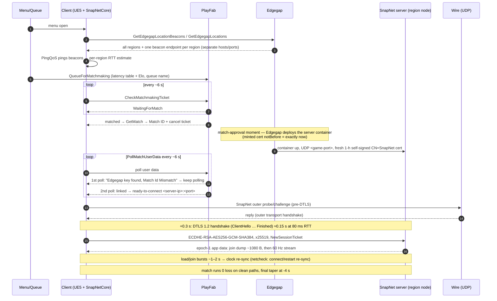
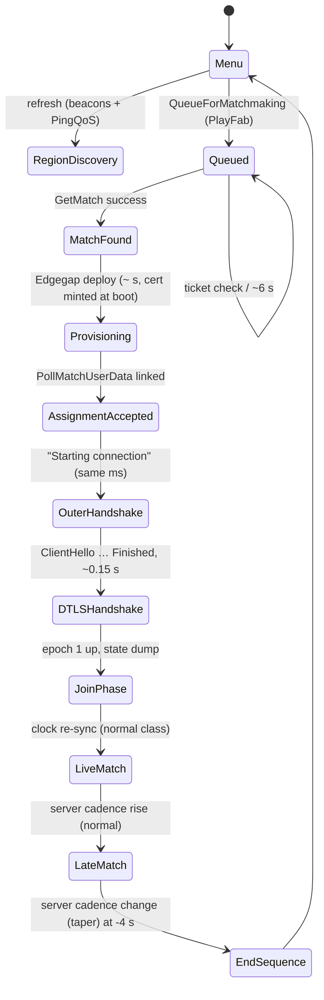

# RIVALS 2 — lobby, matchmaking and session setup lifecycle

Grounded in full capture chains (per-server pcap + scout `*_pre_*` side-file +
log snapshot + ICMP ping; example: the Oct 22 run whose set landed in London —
chosen only as a mid-RTT sample; the lifecycle is region-independent).
Log timestamps are UTC; wire timestamps are local (UTC−4). Evidence pointers
given as log line numbers and scout-capture frame numbers.

## 1. Actors and infrastructure

```
+-----------------+        HTTPS (PlayFab)           +-------------------+
| RIVALS 2 client  | <------------------------------> | PlayFab login &   |
| (UE5, Windows,   |                                  | matchmaking       |
|  Proton)         |                                  +-------------------+
|                  |        HTTPS (Edgegap API)       +-------------------+
|  SnapNetCore.dll | <------------------------------> | Edgegap control    |
|  OpenSSL 1.1.1w  |                                  | (deploys/regions)  |
|                  |                                  +-------------------+
|                  |  UDP beacons/menu-ping, DTLS game +-------------------+
|                  | ---------------------------------> | SnapNet dedicated  |
+-----------------+                                     | server (Edgegap    |
                                                        | node, any region)  |
                                                        +-------------------+
```

Mermaid equivalent:



* Client runs SnapNet 5.9.0 over a UDP transport whose payload is a DTLS 1.2 session
  (OpenSSL 1.1.1w statically linked into SnapNetCore.dll).
* The dedicated server is an **Edgegap-deployed container**: a fresh deployment is
  created per match, in the chosen region, and minted its own TLS cert at boot
  (see §4).

## 2. Menu-time region discovery (only happens when the lobby/menu refreshes)

```
Menu (in game)
  |
  |--> GetEdgegapLocationBeacons  --> 20 beacon endpoints (odd pages),
  |         one host + tcp/udp port pair per region, e.g.
  |               fqdn b-????????????.pr.edgegap.net, host <beacon-ip>, udp <port>
  |--> GetEdgegapLocations        --> 31 playable regions, 4 pages
  |--> PingQoS worker: pings every beacon UDP port, then repeats (~ every 2 min)
  |       Result: "Single Beacon Complete: (Region: <region>, Ping: N)"
  |
  These latencies feed the PlayFab queue attributes verbatim.
```

Beacon pings are a SEPARATE UDP sub-protocol (inner SnapNet tag bytes `0x02 0xe9`
family), NOT the game transport — they use separate beacon hosts per region.

## 3. Queue and match event sequence (PlayFab matchmaking)

Generic flow (measured example values from the Oct 22 run in parentheses):

| phase | event | example measured |
|--|--|--|
| enqueue | previous match left → `Cancel All Matchmaking Tickets`, then `QueueForMatchmaking` with **latency table** (all regions), Elo/tier, UserIP | queue `Alt_Singles`, Elo 1221, London 77 ms |
| queue | ticket status check every **~6 s** — repeated `WaitingForMatch` | ×10 in the example |
| matched | `GetMatch` → **Match ID** (uuid) + ticket cancellation | `a69f8d88-…` at +69 s in queue |
| provision | **Edgegap deploys the container**; server mints its own cert at boot (cert `notBefore` = this moment) | notBefore 4 s before ClientHello |
| data-poll round 1 | `PollMatchUserData`: "**Edgegap key found!** … Match Id Mismatch or Split failed, continue polling" (deployment record exists but not yet linked to this match ID) | +6.3 s after GetMatch |
| data-poll round 2 | ID matches → **same-millisecond block**: `IP:PORT_<Region>` / `Verifying Region: <region>` / `Region is Accepted!` / `ready-to-connect, <ip>:<port>` / `Starting connection to server at …` / `InitializeReconnectData` / HUD MODE CHANGED 0 / SnapNet protocol init | accepted 6 s later |

Datagram timeline relative to `Starting connection` (t₀=assignment ms) — generic
shape, example RTT 80 ms (scale the deltas roughly with RTT for other regions):

| t₀ | frame (scout side-file) | datagram |
|--|--|--|
| +0.045 | f1 | SnapNet outer-level probe C→S (all-zero body) |
| +0.14 | f2 | S→C 37 B reply (outer tag `0x00e9`) |
| +0.15 | f3 | C→S 185 B reply (outer tag `0x01e9`) — **outer transport challenge/response** (pre-DTLS) |
| +0.317 | f5 | ClientHello, epoch 0 record seq 0 |
| +0.367 | f6 | ServerHello + Certificate + ServerKeyExchange + ServerHelloDone (1186 B, 4 records) |
| +0.394/0.452 | f7 | ClientKeyExchange, ChangeCipherSpec (epoch→1), client Finished (enc) |
| +0.454/0.467 | f8 | NewSessionTicket, ChangeCipherSpec, server Finished (enc) |
| +0.469→.49 | f9+ | epoch-1 ApplicationData begins, 1080-B dump ~0.1 s later (state sync) |

Total handshake ≈ **0.15 s at 80 ms RTT** (4 flight round trips + crypto); at 10 ms
RTT (near-local region) proportionally faster — which is exactly why the
per-server capture spawned on the assignment line can never catch it (see §6).

## 4. The server as deployed

```
+----------------------------------------------------------+
| Edgegap node (region label from the client's accepted      |
| region string, e.g. "_<Region>")                           |
|                                                            |
| SnapNet container (deployed at match approved)             |
| - UDP port <game-port> (game/DTLS)                         |
| - OpenSSL 1.1.1w DTLS server                               |
| - cert: CN=SnapNet, self-signed, RSA-2048,                  |
|         sha256WithRSAEncryption, validity 1 hour            |
|         (server generates it at boot; client imports but    |
|         never validates -> the "no trusted certificate"     |
|         SECURITY VULNERABILITY log line is expected)        |
| - cipher pinned -> ECDHE-RSA-AES256-GCM-SHA384, x25519      |
| - NewSessionTicket after handshake                         |
+------------------------------------------------------------+
```

## 5. Match/session phases (in-match netcode view)



```
  assignment    +0.3s         +1s..~10s              ~10s              match end
     |            |               |                    |                  |
  ready-to-     DTLS done      JOIN PHASE            snap-to-live        END OF MATCH
  connect       epoch 1 up     (game state push,     (60 Hz normal)      taper: server
                               join bursts, clock                        cadence change
                               corrections; netcheck                     in the last ~4-8s;
                               classes: connect/restart                  netcheck "taper")
                               re-sync — normal)
```

The per-session findings (loss, latency profile, join bursts, taper presence,
event attributions) live in each session's `*_netcheck.md` report.

## 6. What "capture vs. wire" looks like to our tooling

* Per-server capture is spawned out of the log's `ready-to-connect` line — it can
  only see epoch-1 data (et. Newark: client record seq already 0x43 at frame 1).
* The scout (runs from script start, ring buffer, full frames) holds ALL of the
  handshake — `dtls_decode_handshake.py` turns its side-file into the §3 table.
* Matchmaking queue/match IDs (PlayFab) are visible in the snapshot log;
  the Edgegap reserve loop is observable through the one "Edgegap key found,
  Match Id Mismatch" poll round (≤6 s from server boot to connect-able).

## 7. Failure mode silhouettes worth knowing

* **Blocked watcher** — if `sudo` expires, the script stalls at capture spawn
  (session captured 0 pkts; the flow above still runs but nothing is recorded).
  Fixed with upfront password prompt + keepalive refresh.
* Queue exits without a match assignment leave no ready-to-connect line to
  detect; the watcher simply keeps waiting.
