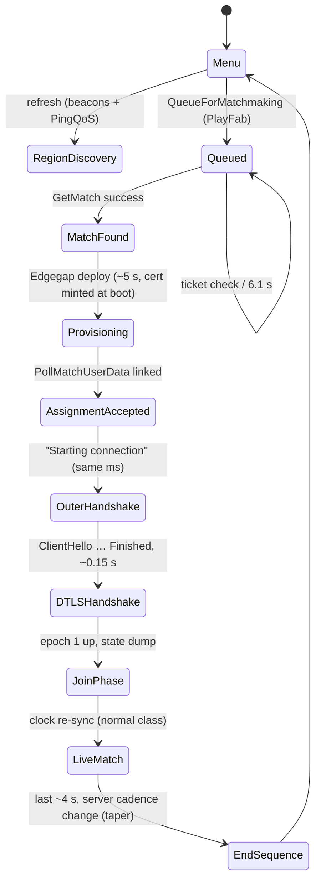

# RIVALS 2 — lobby, matchmaking and session setup lifecycle

Grounded in the Oct 22 2026 London capture chain
(`20261022_143635_*` — per-server pcap + `<TS>_pre_*.` scout side-file + log snapshot
+ ICMP ping), cross-checked against the Newark/Council runs. Log timestamps are UTC;
wire timestamps are local (UTC−4). Evidence pointers given as log line numbers and
scout-capture frame numbers.

## 1. Actors and infrastructure

```
+-----------------+        HTTPS (PlayFab)          +------------------+
| RIVALS 2 client  | <-----------------------------> | PlayFab login &  |
| (UE5, Windows,   |                                 | matchmaking      |
|  Proton)         |                                 +------------------+
|                  |        HTTPS (Edgegap API)      +------------------+
|  SnapNetCore.dll | <-----------------------------> | Edgegap control   |
|  OpenSSL 1.1.1w  |                                 | (deploys/regions) |
|                  |  UDP beacons/DTLS game          +------------------+
|                  | --------------------------------> | SnapNet dedicated |
+-----------------+                                  | server (Edgegap   |
                                                      | node, e.g. London)|
                                                      +------------------+
```

```mermaid
sequenceDiagram
    autonumber
    participant M as Menu/Queue
    participant C as Client (UE5 + SnapNetCore)
    participant PF as PlayFab
    participant EG as Edgegap
    participant S as SnapNet server (region node)
    participant W as Wire (UDP)

    M->>C: menu open
    C->>EG: GetEdgegapLocationBeacons / GetEdgegapLocations
    EG-->>C: 31 regions, 20 beacon endpoints (London beacon 172.236.30.158:32401)
    C->>C: PingQoS pings beacons → "London ping 82"

    M->>PF: QueueForMatchmaking (latency table + Elo, queue Alt_Singles)
    loop every 6.1 s
        C->>PF: CheckMatchmakingTicket
        PF-->>C: WaitingForMatch
    end
    PF-->>C: matched → GetMatch → Match ID a69f8d88… + cancel ticket
    Note over EG: 18:36:30 — Edgegap deploys the server container<br/>(minted cert notBefore = exactly now)
    EG->>S: container up, UDP 30219, fresh 1-h self-signed CN=SnapNet cert

    loop PollMatchUserData every 6 s
        C->>PF: poll user data
        PF-->>C: 1st poll: "Edgegap key found, Match Id Mismatch" → keep polling
        PF-->>C: 2nd poll: linked → ready-to-connect 172.239.124.176:30219
    end

    C->>W: SnapNet outer probe/challenge (pre-DTLS)
    W-->>C: reply (tags 0x00e9/0x01e9)
    Note over C,S: +0.32 s: DTLS 1.2 handshake (ClientHello … Finished) ≈0.15 s at 80 ms RTT
    C->>S: ECDHE-RSA-AES256-GCM-SHA384, x25519, NewSessionTicket
    S-->>C: epoch-1 app data: join dump 1080 B, then 60 Hz stream
    Note over C,S: load/join bursts ~1–2 s → clock re-sync (netcheck: connect/restart re-sync)
    Note over C,S: match runs 0 loss, flat RTT; final taper at -4 s
```

* Client runs SnapNet 5.9.0 over a UDP transport whose payload is a DTLS 1.2 session
  (OpenSSL 1.1.1w statically linked into SnapNetCore.dll).
* The dedicated server is an **Edgegap-deployed container**: a fresh deployment is
  created per match, in the chosen region, and minted its own TLS cert at boot
  (see §4).

## 2. Menu-time region discovery (only happens when the lobby/menu refreshes)

`[2026.10.22-18.02.32]` (log lines 1401–3461)

```
Menu (in game)
  |
  |--> GetEdgegapLocationBeacons  --> 20 beacon endpoints, per region:
  |         e.g. London beacon fqdn b-eca9adca35e7.pr.edgegap.net
  |               host 172.236.30.158, tcp 31864, udp 32401
  |--> GetEdgegapLocations        --> 31 playable regions, 4 pages
  |--> PingQoS worker: pings every beacon UDP port repeatedly (~ every 2 min run)
  |       Result: "Single Beacon Complete: (Region: London, Ping: 82)" (xN)
  |       London 82 / WestEurope 82 / Miami 39 ... (log HostLatencyTable below)
  |
  These latencies feed the PlayFab queue attributes.
```

Beacon pings are a SEPARATE UDP sub-protocol (inner SnapNet tag bytes `0x02 0x1e9`
style), NOT the game transport — they use separate beacon hosts per region.

## 3. Queue and match event sequence (PlayFab matchmaking)

London run, one real match — times UTC:

| t (UTC) | event | evidence |
|--|--|--|
| 14:35:12.570 | previous match left; `Cancel All Matchmaking Tickets … MatchFound: false` then `QueueForMatchmaking` | log 11009–11012 |
| 14:35:12.587 | queue attributes POST: **latency table** (Newark 10, Toronto 14, Chicago 20, Ashburn 12, Atlanta 32, Council Bluffs 26, Miami 37, Dallas 48, Queretaro 55, Seattle 62, Fremont 68, LA 69, **London 77**), `Elo 1221`, `Separator 2`, UserIP `68.198.213.202`, queue `Alt_Singles` | log 11013 |
| … | ticket status check every **6.1 s** — `WaitingForMatch` ×10 | 11014–11059 |
| 14:36:21.614 | ticket matched → `GetMatch` → **Match ID** `a69f8d88-…`; `Cancel All Matchmaking Tickets In Queue Requested! MatchFound: true` | log 11071–11077 |
| 14:36:30 | **Edgegap deploys the server container** (ClientHello cert notBefore = 18:36:30 — server boot minted it) | scout `server_cert_0.der` |
| 14:36:27.991 | poll #1 `PollMatchUserData`: "**Edgegap key found!** … Match Id Mismatch or Split failed, continue polling" (deployment record exists but not yet linked to this match ID) | log 11087–11088 |
| 14:36:33.993 → .34:096 | poll #2: ID now matches. **Same-millisecond block**: `IP:30219_London` / `Verifying Region: London` / `Region is Accepted!` / `ready-to-connect, 172.239.124.176:30219` / `Starting connection to server at …` / `InitializeReconnectData` / HUD MODE CHANGED 0 / SnapNet protocol init ("Hashing SnapNet version string: 5.9.0") | log 11087–11102 |

Datagram timeline relative to `Starting connection` (t₀=assignment ms):

| t₀ | frame (scout side-file) | datagram |
|--|--|--|
| +0.045 | f1 | SnapNet outer-level probe C→S (all-zero body) |
| +0.14 | f2 | S→C 37 B reply, tag `0x0002_0x00e9` |
| +0.15 | f3 | C→S 185 B reply, tag `0x0002_0x01e9` — **outer transport challenge/response** (pre-DTLS) |
| +0.317 | f5 | ClientHello, epoch 0 record seq 0 |
| +0.367 | f6 | ServerHello + Certificate + ServerKeyExchange + ServerHelloDone (1186 B, 4 records) |
| +0.394/0.452 | f7 | ClientKeyExchange, ChangeCipherSpec (epoch→1), client Finished (enc) |
| +0.454/0.467 | f8 | NewSessionTicket, ChangeCipherSpec, server Finished (enc) |
| +0.469→.49 | f9+ | epoch-1 ApplicationData begins, 1080-B dump ~0.1 s later (state sync) |

Total handshake ≈ **0.15 s at 80 ms RTT** (4 flight round trips + crypto).

## 4. The server as deployed

```
+----------------------------------------------------------+
| Edgegap node (region label from the client's accepted     |
| region string, e.g. "_London")                            |
|                                                           |
| SnapNet container (deployed at ~18:36:30 on match approved)|
| - UDP port 30219 (game/DTLS)                              |
| - OpenSSL 1.1.1w DTLS server                              |
| - cert: CN=SnapNet, self-signed, RSA-2048,                 |
|         sha256WithRSAEncryption, validity 1 hour           |
|         (server generates it at boot; client imports but   |
|         never validates -> the "no trusted certificate"    |
|         SECURITY VULNERABILITY log line is expected)       |
| - cipher pinned -> ECDHE-RSA-AES256-GCM-SHA384, x25519     |
| - NewSessionTicket after handshake                        |
+----------------------------------------------------------+
```

## 5. Match/session phases (in-match netcode view)



```
  assignment    +0.3s         +1s..~10s              ~10s              match end
     |            |               |                    |                  |
  ready-to-     DTLS done      JOIN PHASE            snap-to-live        END OF MATCH
  connect       epoch 1 up     (game state push,     (60 Hz normal)      taper: server
                               join bursts, clock                        cadence change
                               corrections; netcheck                     in the last ~4-8s;
                               classes: connect/restart                  netcheck "taper")
                               re-sync — normal)
```

The netcode-level findings (0 loss, latency flat, join bursts cluster in the
assume-locked phase, end-of-match taper in 4/4 London+reference sets) live in the
`*_netcheck.md` report for each session.

## 6. What "capture vs. wire" looks like to our tooling

* Per-server capture is spawned out of the log's `ready-to-connect` line — it can
  only see epoch-1 data (et. Newark: client record seq already 0x43).
* The scout (runs from script start, ring buffer, full frames) holds ALL of the
  handshake — see `20261022_143635_pre_172.239.124.176_30219_.pcapng`, frames 5–8.
  `dtls_decode_handshake.py` turns it into the summary in §3's table.
* Matchmaking PID/queue/match IDs (PlayFab) are visible in the snapshot log;
  the Edgegap reserve loop is observable through the one "Edgegap key found,
  Match Id Mismatch" poll round (≤6 s from server boot to connect-able).

## 7. Failure mode silhouettes worth knowing

* **Miami (14:21)** — the match was assigned but the watcher was blocked by
  `sudo: a password is required` (capture never attached; 0 pkts on wire). Void
  session; the flow above only works when sudo is fresh (keepalive fix).
* Games whose payload's group ChatLog shows *no ready-to-connect* line in ~ the
  relevant window are usually queue exits (no access log to even see).
